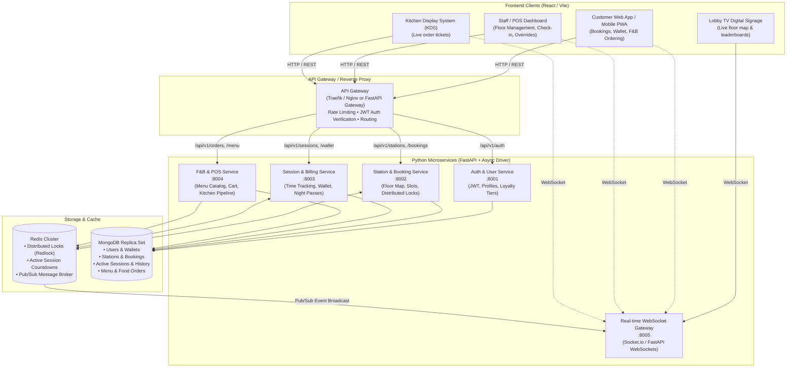

# Game Cafe — Microservice Architecture & Data Design

## 1. High-Level System Architecture



---

## 2. Microservice Decomposition (Python / FastAPI)

| Service | Responsibility | Key Endpoints | Primary Database / Cache |
| :--- | :--- | :--- | :--- |
| **1. Auth & User Service** | Registration, Login (JWT/OAuth), Gamer Profile, Loyalty Tiers (XP), Roles (Gamer, Staff, Admin, Kitchen). | `POST /auth/register`<br>`POST /auth/login`<br>`GET /users/me`<br>`GET /users/{id}/xp` | MongoDB (`users` collection) |
| **2. Station & Booking Service** | Station inventory (PC, Console, Board Game tables), visual floor map layout, time slot availability, reservation engine. | `GET /stations/floor-map`<br>`POST /bookings/hold`<br>`POST /bookings/confirm`<br>`GET /bookings/my` | MongoDB (`stations`, `bookings`)<br>Redis (Distributed Lock: `lock:station:{id}:{slot}`) |
| **3. Session & Billing Service** | Active session timer, dynamic hourly rates (peak/off-peak), wallet top-up, package passes, auto-extension, grace period checks. | `POST /sessions/start`<br>`POST /sessions/extend`<br>`POST /sessions/stop`<br>`POST /wallet/topup`<br>`GET /wallet/balance` | MongoDB (`sessions`, `transactions`, `wallets`)<br>Redis (TTL timers, session heartbeats) |
| **4. F&B Order & POS Service** | Food & drink menu catalog, station-tagged cart, order lifecycle management (Pending $\rightarrow$ Preparing $\rightarrow$ Ready $\rightarrow$ Delivered), kitchen display updates. | `GET /menu`<br>`POST /orders`<br>`GET /orders/station/{station_id}`<br>`PATCH /orders/{id}/status` | MongoDB (`menu_items`, `orders`)<br>Redis (Publishes `order.created`, `order.status_changed`) |
| **5. Real-Time WebSocket Gateway** | Manages WebSocket connections with React clients. Subscribes to Redis Pub/Sub channels and broadcasts events to appropriate rooms (e.g. `room:floor`, `room:station_{id}`, `room:kitchen`). | `WS /ws/connect`<br>Event channels: `station.status`, `session.timer_tick`, `order.kds` | Redis (Pub/Sub message subscriber) |

---

## 3. MongoDB Collections & Schema Design

### A. `users` & `wallets`
```json
{
  "_id": "ObjectId",
  "username": "shadow_ninja",
  "email": "user@example.com",
  "phone": "+1234567890",
  "role": "GAMER", // "GAMER" | "STAFF" | "KITCHEN" | "ADMIN"
  "wallet": {
    "balance": 45.50,
    "currency": "USD"
  },
  "loyalty": {
    "tier": "GOLD", // "BRONZE" | "SILVER" | "GOLD" | "DIAMOND"
    "xp": 3400,
    "discount_percent": 10
  },
  "created_at": "ISODate"
}
```

### B. `stations`
```json
{
  "_id": "ObjectId",
  "code": "PC-VIP-01",
  "zone": "VIP_ESPORTS", // "STANDARD_LAN" | "VIP_ESPORTS" | "CONSOLE_BOOTH" | "BOARD_GAME"
  "type": "PC", // "PC" | "CONSOLE" | "TABLE" | "SIMULATOR"
  "specs": {
    "gpu": "NVIDIA RTX 4080",
    "cpu": "Intel i9-14900K",
    "monitor": "240Hz 27-inch OLED",
    "peripherals": "Logitech G Pro X Superlight + Mechanical Blue"
  },
  "map_coordinates": {
    "floor": 1,
    "x": 240,
    "y": 180,
    "width": 60,
    "height": 60
  },
  "hourly_rate": {
    "standard": 8.00,
    "peak": 10.00
  },
  "current_status": "AVAILABLE" // "AVAILABLE" | "HELD" | "OCCUPIED" | "MAINTENANCE"
}
```

### C. `bookings`
```json
{
  "_id": "ObjectId",
  "user_id": "ObjectId",
  "station_id": "ObjectId",
  "start_time": "2026-11-07T15:00:00Z",
  "end_time": "2026-11-07T18:00:00Z",
  "duration_minutes": 180,
  "pricing_type": "PACKAGE", // "HOURLY" | "PACKAGE" ("NIGHT_OWL")
  "total_amount": 25.00,
  "status": "CONFIRMED", // "PENDING_PAYMENT" | "CONFIRMED" | "CHECKED_IN" | "COMPLETED" | "CANCELLED" | "NO_SHOW",
  "payment_id": "tx_9983421"
}
```

### D. `orders` (F&B)
```json
{
  "_id": "ObjectId",
  "order_number": "ORD-1042",
  "user_id": "ObjectId",
  "station_id": "ObjectId",
  "station_code": "PC-VIP-01",
  "items": [
    {
      "item_id": "ObjectId",
      "name": "Monster Energy Ultra",
      "quantity": 1,
      "price": 3.50
    },
    {
      "item_id": "ObjectId",
      "name": "Crispy Loaded Fries",
      "quantity": 1,
      "price": 5.99,
      "notes": "Extra jalapeños"
    }
  ],
  "total_amount": 9.49,
  "payment_method": "WALLET", // "WALLET" | "ONLINE" | "CASH_AT_COUNTER"
  "status": "PREPARING", // "RECEIVED" | "PREPARING" | "READY_FOR_DELIVERY" | "SERVED" | "CANCELLED",
  "created_at": "ISODate"
}
```

---

## 4. How Redis Powers the Core Business Logic

### 1. Distributed Seat Locking (Prevent Double Bookings)
When a gamer selects a station for a specific time window, we place a 5-minute temporary hold:
```text
SET lock:station:{station_id}:{date_slot} "{user_id}" NX EX 300
```
- If `NX` fails $\rightarrow$ Another user is already checking out that exact slot.
- Once payment is confirmed $\rightarrow$ Persist booking to MongoDB and release or convert lock.
- If user abandons cart $\rightarrow$ Redis key expires in 300 seconds automatically, freeing the seat.

### 2. Active Session Heartbeats & Expiration Timers
For active sessions:
```text
HSET session:active:{station_id} user_id "..." started_at 1730960000 ends_at 1730970800 mode "PREPAID"
EXPIRE session:active:{station_id} {remaining_seconds}
```
Redis keyspace notifications trigger warning events when 15 min / 5 min remain.

### 3. Microservice Event Pub/Sub
- `station.status_changed` $\rightarrow$ WebSocket Gateway broadcasts to Floor Map clients.
- `order.created` $\rightarrow$ WebSocket Gateway pushes to Kitchen Display System (KDS).
- `session.warning` $\rightarrow$ Broadcasts alert popup to the gamer's client.

---

## 5. React Frontend Structure

```text
frontend/
├── src/
│   ├── assets/              # Icons, sounds, floor plan SVGs
│   ├── components/
│   │   ├── floor-map/       # Interactive SVG/Canvas seat picker (zoom/pan, live status)
│   │   ├── booking/         # Time slot picker, checkout modal, split-bill modal
│   │   ├── session/         # Floating session timer widget, extension button
│   │   ├── fnb/             # Food catalog, quick-add combos, in-seat cart
│   │   ├── kds/             # Kitchen Display tickets with countdown timers
│   │   ├── admin/           # Live floor table, revenue graphs, station toggles
│   │   └── ui/              # Button, Modal, Badge, Sheet (Tailwind + Lucide)
│   ├── hooks/
│   │   ├── useWebSocket.ts  # Centralized real-time listener
│   │   ├── useSession.ts    # Current gameplay session & countdown
│   │   └── useFloorMap.ts   # Live station states
│   ├── pages/
│   │   ├── Customer/        # Landing, Floor Map, My Bookings, Wallet, Menu
│   │   ├── Staff/           # Front desk check-in, station switcher, cash top-ups
│   │   ├── Kitchen/         # KDS screen
│   │   └── LobbyTV/         # Fullscreen public display view
│   └── store/               # Zustand / Redux Toolkit (auth, cart, active session)
```

---

## 6. Android App Transition Strategy & Mobile-First API Design

Because this platform will expand to an Android application, our backend and client state must be architected from Day 1 to support cross-platform parity without code rewrites.

### A. Mobile-Friendly API Principles (FastAPI)
1. **Stateless JWT Bearer Authentication**:
   - Strictly avoid browser-only cookies for auth.
   - Use standard `Authorization: Bearer <jwt_access_token>` headers with refresh tokens. Both React and Android (Retrofit / OkHttp) consume this identically.
2. **OpenAPI / Swagger Contract-First**:
   - FastAPI auto-generates `/openapi.json`.
   - When building the Android app, Retrofit network interfaces and Kotlin data classes can be automatically generated via OpenAPI Generator CLI:
     ```bash
     openapi-generator-cli generate -i http://localhost:8000/openapi.json -g kotlin -o android-sdk/
     ```
3. **Push Notification Ready (FCM)**:
   - Include `device_tokens` array in the `users` MongoDB document:
     ```json
     "device_tokens": [
       { "token": "fcm_token_...", "platform": "android", "updated_at": "ISODate" }
     ]
     ```
   - Essential for native Android notifications (e.g., *"Your booking for PC-VIP-02 starts in 15 minutes"*, *"Loaded Fries are on their way to your station"*).

### B. Selected Mobile Framework: React Native (Expo)
By selecting **React Native (with Expo)**, we unlock a **Shared Monorepo Architecture**:
- **80%+ Shared Code**: Data models, API clients, validation schemas (Zod), and state management stores (Zustand) can live in a shared package (`packages/shared`), imported directly by both the React Web App (`apps/web`) and the React Native Android App (`apps/mobile`).
- **Expo Camera**: Instant, hardware-accelerated QR scanning at gaming rigs.
- **Expo Notifications**: Integrated push notification delivery via FCM.
- **Cross-Platform**: Ready for both Android and iOS with zero extra backend effort.

```text
Cafe/
├── apps/
│   ├── web/                    # React (Vite) - Desktop/Mobile Web, Staff POS, KDS, Lobby TV
│   └── mobile/                 # React Native (Expo) - Gamer Android App (QR Scan, Wallet, Timers)
├── packages/
│   └── shared/                 # Shared TypeScript models, API clients, Zustand state & hooks
├── services/                   # Python FastAPI Microservices
│   ├── auth-service/
│   ├── booking-service/
│   ├── session-service/
│   ├── order-service/
│   └── realtime-gateway/
├── docker-compose.yml          # MongoDB + Redis infrastructure
└── ARCHITECTURE.md
```

### C. Android-Specific Game Cafe Features (React Native Expo)
1. **In-Cafe QR Station Scanner**:
   - Tap "Scan Rig" $\rightarrow$ Camera scans QR on monitor $\rightarrow$ Loads station session or unlocks PC.
2. **Digital Membership Card / NFC / Google Wallet**:
   - Barcode/QR code on screen to scan at the front desk for fast check-in and loyalty XP.
3. **Live Persistent Lock-Screen Notification**:
   - An ongoing notification while playing: *"PC-04 Session: 42m remaining | Extend Time"*.

