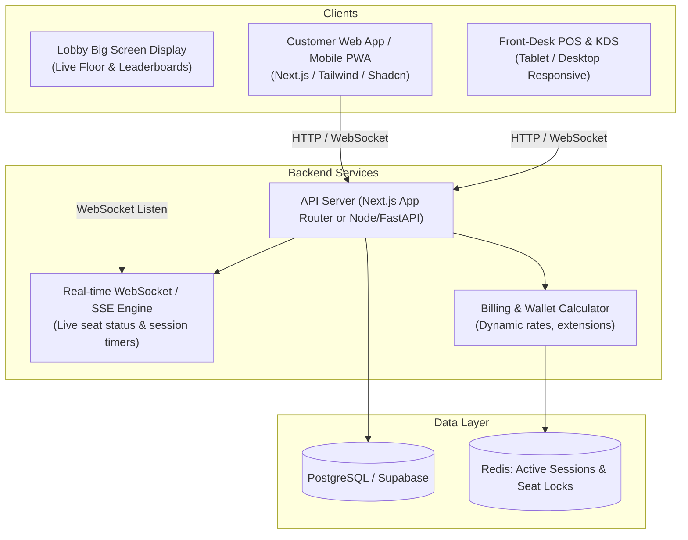

# Gaming Cafe Web App — Product Architecture & Brainstorming

## 1. Updated MVP Scope & Core Requirements

Based on latest requirements, the initial rollout focuses on a **frictionless booking & UPI payment flow** (no complex virtual currency/wallet):

1. **Authentication:**
   - **Google SSO**: One-click Google login for fast onboarding.
   - User profile displayed in the top header with avatar, name, and active passes.
2. **Devices / Stations Showcase:**
   - Visual device selector in the middle of the screen (PS5, PC Gaming Rigs, Racing Simulators, Nintendo Switch).
   - **Default Selected Device: PlayStation 5 (PS5)**.
3. **Slot Availability & Multi-Hour Booking:**
   - Date picker (Today, Tomorrow, Weekend).
   - Available time slots listed below the selected device (1-hour minimum).
   - Customers can select **multiple consecutive or separate slots** (e.g. 2:00 PM – 4:00 PM).
4. **Checkout & Guest Selection:**
   - For PS5: **Guest count / controller selector** (1 to 4 players) so the cafe preps the required DualSense controllers.
   - Option to redeem hours from an **Active Pass** or pay directly.
5. **Payment Method:**
   - **UPI Payment**: Dynamic QR code (GPay, PhonePe, Paytm, BHIM) + UPI Deep Link (`upi://pay?...`) + UPI ID.
   - Optional fallback: Pay Cash at counter.

---

## 2. Key User Roles & Personas

| Role | Primary Needs & Actions |
| :--- | :--- |
| **Gamer / Customer** | Book stations in advance, top up wallet/pass, view live available seats, order snacks to seat, check tournaments, view gameplay stats/achievements. |
| **Front Desk / Cashier** | Check-in walk-ins, assign/switch stations, handle cash/card payments, apply discounts, extend time, handle refunds. |
| **Kitchen / Barista Staff** | Kitchen Display System (KDS): view incoming food/drink orders tagged with station IDs (e.g. "PC-12", "PS5-Booth-2"), update fulfillment status. |
| **Admin / Store Owner** | Revenue analytics, hourly occupancy heatmaps, pricing rules (peak vs off-peak), inventory & peripheral tracking, staff access control. |

---

## 3. Core Business Logic & Workflows

### A. Station / Resource Management & Booking Engine
1. **Zone & Station Types**:
   - PC Stations (Standard, VIP 240Hz/RTX 4090, Streaming Pods).
   - Console Booths (PS5, Xbox Series X, Nintendo Switch couch co-op).
   - Board Game / Tabletop Tables (2-seater, 4-seater, 8-seater private dungeon room).
   - Racing Simulator / VR rigs.
2. **Reservation Logic**:
   - **Time Slot Granularity**: 30-minute or 1-hour increments.
   - **Buffer Time**: Automated 10-15 minute cleaning/reset buffer between consecutive bookings.
   - **Grace Period**: 15 minutes before the reservation is marked as "No-Show" and released back to walk-in pool.
   - **Interactive Visual Floor Map**: Live color-coded SVG/Canvas map:
     - 🟢 Green: Available
     - 🔴 Red: In-Use / Occupied (with countdown timer)
     - 🟡 Yellow: Reserved / Awaiting check-in
     - ⚪ Gray: Maintenance / Broken peripheral
3. **Walk-in Fast Check-in**:
   - Scan QR code at the desk or station monitor to instantly claim an available seat and start a session.

---

### B. Session Lifecycle & Billing Engine
1. **Billing Models**:
   - **Prepaid (Pay-as-you-go / Wallet)**: Gamer deposits \$20 into their wallet; rates deduct dynamically per minute/hour.
   - **Fixed Package Deals**: E.g. "Night Owl Pass" (11 PM - 7 AM for \$25), "3-Hour Gamer Combo" (includes drink).
   - **Postpaid / Open Tab**: Pay at front desk upon checkout (often tied to a government ID or verified member account).
2. **Dynamic / Tiered Pricing**:
   - Base Rate (e.g., \$5/hr weekdays).
   - Peak Hours (e.g., \$7/hr Friday evening & Weekends).
   - VIP/Sim Rigs (e.g., \$12/hr).
   - Member discounts (Gold tier = 15% off station rates).
3. **Session Warnings & Auto-Actions**:
   - 10-minute and 5-minute warning notifications (SMS / Web push / On-screen prompt).
   - One-click "Extend 1 Hour" button if station has no upcoming booking.
   - Graceful session lock when balance drops to zero.

---

### C. In-Seat F&B Ordering (Food & Drink POS)
1. **Workflow**:
   - Gamer scans QR code on desk (or orders via their logged-in active session dashboard).
   - Cart automatically links to their active Station ID (e.g., `VIP-04`).
   - Payment options: Deduct from Gamer Wallet balance, Online Card/UPI payment, or Add to Tab.
   - Order sent instantly to Kitchen/Bar terminal.
   - Staff delivers food directly to the station without interrupting game.
2. **Combos & Upselling**:
   - "Level-Up Combo": Add fries and energy drink for \$4.
   - Time + Snack bundle discounts.

---

### D. Community, Tournaments & LFG (Looking for Group)
1. **LFG Matchmaking Board**:
   - Gamers can post "Looking for +2 for Valorant competitive right now" or "Looking for 2 players for Catan at Table 3".
   - Nearby/active cafe guests get a notification or see it on the lobby digital signage.
2. **Tournament Brackets**:
   - Automated Single/Double Elimination brackets for cafe events (FIFA, CS2, Tekken, Smash Bros).
   - Prize pool distribution to player wallets.
3. **Gamification & Loyalty**:
   - XP gained per hour played + dollars spent.
   - Badges (e.g., "Night Owl", "Century Club: 100 Hours", "Tournament Finalist").

---

## 4. Edge Cases & Tricky Scenarios to Address

1. **Station Malfunction / Mid-Session Transfer**:
   - If a PC freezes or peripheral fails, staff must be able to "Transfer Session" from PC-03 to PC-08 seamlessly without losing paid time or active food orders.
2. **Overstaying vs Next Booking Collision**:
   - What if a player in PC-05 wants to extend, but another customer reserved PC-05 in 15 minutes?
   - *Logic*: System disallows extension for that specific PC, but recommends the nearest available PC and offers seamless seat transfer.
3. **Split Payments for Group Bookings**:
   - 4 friends book a Console Lounge or Board Game table. Allow the organizer to split the cost via generated payment links or deduct proportionally from wallets.
4. **Offline Mode / Network Drop**:
   - Local cafe intranet fallback or cached station timers in case the internet connection blips.

---

## 5. Recommended Architecture & Tech Stack

### Suggested Tech Stack:
- **Frontend**: Next.js 15 (React 19), Tailwind CSS, Shadcn UI / Radix (accessible, modern UI), Lucide Icons, Framer Motion.
- **Backend / API**: Next.js Server Actions / API routes or FastAPI/Node.js.
- **Real-time Engine**: Supabase Realtime, Pusher, or Socket.io (essential for live seat map and countdowns).
- **Database**: PostgreSQL (Prisma or Drizzle ORM) for relational integrity between users, bookings, transactions, and food menus.
- **State & In-Memory**: Redis (for temporary seat holds during checkout and real-time active session heartbeats).
- **Auth**: Auth.js (NextAuth) or Clerk / Supabase Auth (supports Phone OTP, Google OAuth, and Guest walk-ins).
- **Payment Gateway**: Stripe, Razorpay, or local QR/wallet providers depending on region.
