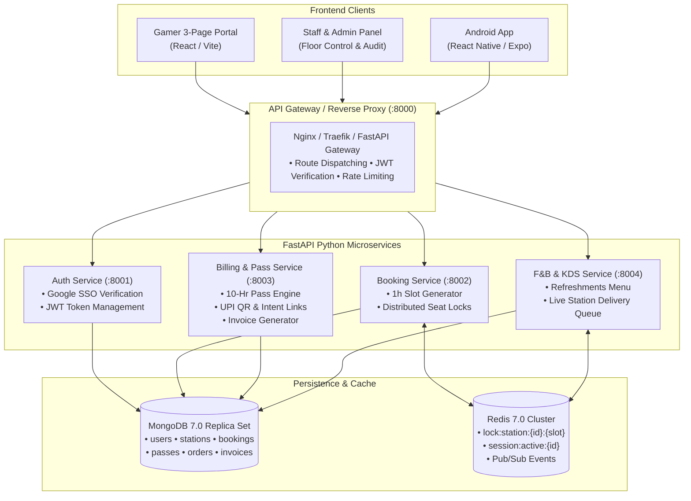

# Nexus Gaming — Technical Design Document (TDD) & Specification

## 1. System Architecture & Domain Boundaries

Nexus Gaming is architected as an asynchronous Python microservice backend with MongoDB document storage and Redis in-memory cache/locking, consumed by a React TypeScript web application (`apps/web`) and prepared for React Native Expo (`apps/mobile`).



---

## 2. MongoDB Collections & Schemas

### A. `users`
```json
{
  "_id": "ObjectId",
  "google_id": "109842189312893812",
  "name": "Deepak Patel",
  "email": "deepakpatel970@gmail.com",
  "avatar_url": "https://lh3.googleusercontent.com/...",
  "role": "GAMER", // "GAMER" | "STAFF" | "ADMIN"
  "active_pass_id": "ObjectId", // Reference to active pass
  "created_at": "2026-11-07T10:00:00Z",
  "updated_at": "2026-11-07T10:00:00Z"
}
```
**Indexes:** `{ google_id: 1 }` (unique), `{ email: 1 }` (unique).

---

### B. `stations`
```json
{
  "_id": "ObjectId",
  "code": "PS5-01",
  "name": "PS5 Elite Lounge (Booth 01)",
  "type": "PS5", // "PS5" | "PC" | "SUITE"
  "zone": "CONSOLE_LOUNGE",
  "hourly_rate": 250.00,
  "is_default": true,
  "specs": {
    "console": "Sony PlayStation 5",
    "display": "55-inch Sony Bravia 4K 120Hz OLED",
    "audio": "Dolby Atmos 3D Audio",
    "remotes_included": 1
  },
  "status": "AVAILABLE", // "AVAILABLE" | "OCCUPIED" | "MAINTENANCE"
  "created_at": "ISODate"
}
```
**Indexes:** `{ code: 1 }` (unique), `{ type: 1 }`, `{ status: 1 }`.

---

### C. `passes`
```json
{
  "_id": "ObjectId",
  "user_id": "ObjectId",
  "pass_type": "10_HOUR_GAMER_PASS",
  "total_hours": 10.0,
  "used_hours": 6.0,
  "remaining_hours": 4.0,
  "valid_until": "2026-12-31T23:59:59Z",
  "status": "ACTIVE", // "ACTIVE" | "EXHAUSTED" | "EXPIRED"
  "created_at": "ISODate"
}
```
**Indexes:** `{ user_id: 1, status: 1 }`.

---

### D. `bookings` & `invoices`
```json
{
  "_id": "ObjectId",
  "invoice_number": "INV-NX-9912",
  "user_id": "ObjectId",
  "customer_name": "Deepak Patel",
  "customer_email": "deepakpatel970@gmail.com",
  "station_id": "ObjectId",
  "station_code": "PS5-01",
  "station_name": "PS5 Elite Lounge (Booth 01)",
  "date": "2026-11-07",
  "slot_ids": [15, 16],
  "start_time": "15:00",
  "end_time": "17:00",
  "duration_hours": 2.0,
  "preloaded_games": ["EA Sports FC 24", "Tekken 8"],
  "personal_psn_login": false,
  "player_count": 2,
  "remotes": {
    "included": 1,
    "extra": 1,
    "fee_per_extra": 50.00,
    "total_remote_fee": 50.00
  },
  "refreshments": [
    { "item_id": "rb_250", "name": "Red Bull Energy (250ml)", "qty": 1, "unit_price": 125.00, "total": 125.00 },
    { "item_id": "fries_p", "name": "Peri-Peri Crinkle Fries", "qty": 1, "unit_price": 99.00, "total": 99.00 }
  ],
  "financials": {
    "station_gross_cost": 500.00,
    "remotes_cost": 50.00,
    "refreshments_cost": 224.00,
    "gross_total": 774.00,
    "paid_by_pass": true,
    "pass_hours_deducted": 2.0,
    "pass_discount_amount": 500.00, // Station time waived
    "net_payable_upi": 274.00 // Remotes + Refreshments
  },
  "payment": {
    "method": "UPI",
    "upi_vpa": "nexusgaming@okhdfcbank",
    "upi_txn_id": "UPI/NX/2026/882194",
    "status": "SETTLED" // "PENDING" | "SETTLED" | "FAILED"
  },
  "session_status": "ACTIVE", // "UPCOMING" | "ACTIVE" | "COMPLETED" | "CANCELLED"
  "created_at": "2026-11-07T14:52:00Z"
}
```
**Indexes:** `{ invoice_number: 1 }` (unique), `{ user_id: 1 }`, `{ station_id: 1, date: 1 }`, `{ "payment.status": 1 }`.

---

## 3. Redis Keys & Distributed Locking Mechanics

| Key Pattern | Data Structure | TTL | Purpose |
| :--- | :--- | :--- | :--- |
| `lock:station:{station_id}:{date}:{slot_id}` | String (`user_id`) | **300 sec (5 min)** | Atomic hold while customer is on the UPI checkout page. |
| `session:active:{station_id}` | Hash (`booking_id`, `end_timestamp`) | Dynamic ($\text{duration} \times 3600$) | Live session countdown and heartbeats. |
| `channel:station_updates` | Pub/Sub Channel | N/A | Broadcasts real-time occupancy updates to WebSockets. |
| `channel:kds_queue` | Pub/Sub Channel | N/A | Pushes real-time drink/food delivery orders to staff screens. |

### Atomic Lock Acquisition Pattern:
```python
async def acquire_slot_locks(redis_client, station_id: str, date: str, slot_ids: list[int], user_id: str) -> bool:
    pipe = redis_client.pipeline()
    for slot in slot_ids:
        key = f"lock:station:{station_id}:{date}:{slot}"
        pipe.set(key, user_id, nx=True, ex=300)
    results = await pipe.execute()
    
    # If any slot was already locked by another user, rollback acquired locks
    if not all(results):
        rollback_pipe = redis_client.pipeline()
        for slot, acquired in zip(slot_ids, results):
            if acquired:
                rollback_pipe.delete(f"lock:station:{station_id}:{date}:{slot}")
        await rollback_pipe.execute()
        return False
    return True
```

---

## 4. Exact Business Logic & Calculation Formula

### Formula:
$$\text{Gross Time Cost} = \text{Duration Hours} \times \text{Station Hourly Rate}$$
$$\text{Extra Remotes Fee} = \max(0, \text{Player Count} - 1) \times ₹50$$
$$\text{Refreshments Subtotal} = \sum (\text{Qty}_i \times \text{Unit Price}_i)$$
$$\text{Gross Total} = \text{Gross Time Cost} + \text{Extra Remotes Fee} + \text{Refreshments Subtotal}$$

### Pass Waiver Rule:
$$\text{Pass Eligible Hours} = \min(\text{Pass Remaining Hours}, \text{Duration Hours})$$
$$\text{Pass Discount Amount} = \text{Pass Eligible Hours} \times \text{Station Hourly Rate}$$

> [!IMPORTANT]
> **Strict Business Invariant:**
> The 10-Hour Pass **strictly waives the station hourly time cost**. Extra remote controller charges and refreshments/drinks are **never discounted by the pass** and are always routed to UPI settlement:
> $$\text{Net Payable via UPI} = (\text{Gross Time Cost} - \text{Pass Discount Amount}) + \text{Extra Remotes Fee} + \text{Refreshments Subtotal}$$

---

## 5. API Contracts & REST Specifications

### 1. `GET /api/v1/stations`
* **Response (200 OK):**
```json
[
  {
    "id": "st_ps5_01",
    "code": "PS5-01",
    "name": "PS5 Elite Lounge (Booth 01)",
    "type": "PS5",
    "hourly_rate": 250.00,
    "is_default": true,
    "booths_ready": 3
  }
]
```

### 2. `GET /api/v1/slots?station_id=st_ps5_01&date=2026-11-07`
* **Response (200 OK):**
```json
[
  { "slot_id": 11, "time_label": "11:00 - 12:00", "status": "AVAILABLE" },
  { "slot_id": 13, "time_label": "13:00 - 14:00", "status": "BOOKED" },
  { "slot_id": 15, "time_label": "15:00 - 16:00", "status": "AVAILABLE" }
]
```

### 3. `POST /api/v1/checkout/calculate`
* **Request Body:**
```json
{
  "station_id": "st_ps5_01",
  "date": "2026-11-07",
  "slot_ids": [15, 16],
  "player_count": 2,
  "selected_games": ["fc24", "tekken8"],
  "personal_psn_login": false,
  "refreshments": [{ "id": "redbull", "qty": 1 }, { "id": "fries", "qty": 1 }],
  "apply_pass": true
}
```
* **Response (200 OK):**
```json
{
  "station_hours": 2.0,
  "station_rate": 250.00,
  "gross_time_cost": 500.00,
  "extra_remotes_count": 1,
  "extra_remotes_fee": 50.00,
  "refreshments_subtotal": 224.00,
  "gross_total": 774.00,
  "pass_applied": true,
  "pass_time_discount": 500.00,
  "net_due_upi": 274.00,
  "upi_payload": {
    "vpa": "nexusgaming@okhdfcbank",
    "intent_url": "upi://pay?pa=nexusgaming@okhdfcbank&pn=NexusGaming&am=274.00&cu=INR&tr=NX_9912",
    "qr_url": "https://api.qrserver.com/v1/create-qr-code/?size=170x170&data=..."
  }
}
```

---

## 6. Test-Driven Development (TDD) Test Suites

The backend will be implemented following strict Test-Driven Development using `pytest`, `pytest-asyncio`, and `httpx`.

### Suite 1: Billing & Pass Deduction Unit Tests (`tests/test_billing.py`)
```python
import pytest
from services.billing_service.calculator import calculate_booking_invoice

def test_pass_covers_time_only():
    """Verify that 10-Hour pass waives 100% of station time, but remotes and food remain due via UPI."""
    invoice = calculate_booking_invoice(
        duration_hours=2.0,
        hourly_rate=250.00,
        player_count=2, # +1 remote = ₹50
        refreshments_total=224.00, # Red Bull + Fries
        pass_remaining_hours=4.0,
        apply_pass=True
    )
    assert invoice.gross_total == 774.00
    assert invoice.pass_discount == 500.00 # 2h * 250
    assert invoice.net_due_upi == 274.00 # 50 (remote) + 224 (food)
    assert invoice.paid_by_pass is True

def test_booking_without_pass():
    """Verify full amount is routed to UPI when pass is not applied."""
    invoice = calculate_booking_invoice(
        duration_hours=2.0,
        hourly_rate=250.00,
        player_count=2,
        refreshments_total=224.00,
        pass_remaining_hours=4.0,
        apply_pass=False
    )
    assert invoice.gross_total == 774.00
    assert invoice.pass_discount == 0.00
    assert invoice.net_due_upi == 774.00
    assert invoice.paid_by_pass is False

def test_partial_pass_hours_split():
    """Verify when user has only 1h left on pass but books 2h: 1h is waived, 1h is charged to UPI."""
    invoice = calculate_booking_invoice(
        duration_hours=2.0,
        hourly_rate=250.00,
        player_count=1, # 0 extra remotes
        refreshments_total=0.00,
        pass_remaining_hours=1.0, # Only 1h left
        apply_pass=True
    )
    assert invoice.gross_total == 500.00
    assert invoice.pass_discount == 250.00 # 1h waived
    assert invoice.net_due_upi == 250.00 # 1h remaining paid via UPI
```

### Suite 2: Distributed Lock & Concurrency Tests (`tests/test_locking.py`)
```python
import pytest
import asyncio
from services.booking_service.locker import acquire_slot_locks

@pytest.mark.asyncio
async def test_simultaneous_booking_collision_prevention(fake_redis):
    """Verify that two users attempting to lock the exact same PS5 slot simultaneously cannot double-book."""
    station_id = "ps5_01"
    date = "2026-11-07"
    slots = [15, 16]

    res_user_a, res_user_b = await asyncio.gather(
        acquire_slot_locks(fake_redis, station_id, date, slots, user_id="user_A"),
        acquire_slot_locks(fake_redis, station_id, date, slots, user_id="user_B")
    )

    # Exactly one user must succeed; the other must fail cleanly
    assert (res_user_a is True and res_user_b is False) or (res_user_a is False and res_user_b is True)
```

### Suite 3: Invoice Document Integrity Tests (`tests/test_invoice.py`)
```python
def test_invoice_contains_all_mandatory_audit_fields(sample_booking_payload):
    """Verify invoice contains GSTIN, customer details, games list, remotes, drinks, and pass status."""
    invoice = generate_tax_invoice(sample_booking_payload)
    assert invoice["invoice_number"].startswith("INV-NX-")
    assert "27AABCN9912E1Z8" in invoice["gstin"]
    assert "EA Sports FC 24" in invoice["preloaded_games"]
    assert invoice["remotes"]["extra"] == 1
    assert invoice["remotes"]["total_remote_fee"] == 50.00
    assert invoice["financials"]["paid_by_pass"] is True
    assert invoice["payment"]["method"] == "UPI"
```
